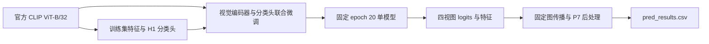

# AIC 2026 · 噪声标签细粒度图像识别

**L35_GRAPH — Robust Fine-tuning with OpenAI CLIP ViT-B/32**

面向第八届全球校园人工智能算法精英大赛复赛的图像识别项目。以 OpenAI 官方 CLIP ViT-B/32 为骨干，通过鲁棒损失、训练历史置信度加权与视觉编码器联合微调学习细粒度类别，再以同一模型的固定四视图预测、特征图传播和类别均衡后处理生成结果。

本仓库保存完整研发代码、实验配置、验证记录与最终 L35 复现源码；配套作品提供模型权重、运行环境、冻结推理缓存和对应提交结果。

| 项目 | 内容 |
| :--- | :--- |
| 参赛团队 | 两股王霸之气 |
| 团队编号 | AIC-2026-43080930 |
| 提交人 | 张延瑞 |
| 最终方案 | **L35_GRAPH**，单模型、固定第 20 轮参数 |
| 复赛最高 Top-1 | **69.6773848947762**（参赛者提供的排行榜成绩） |
| 数据规模 | 148,695 张训练图片 · 750 类 · 37,444 张测试图片 |

[方法](#方法概览) · [结果](#验证结果) · [下载](#代码数据与完整作品) · [快速复现](#快速复现) · [训练与验证](#训练与验证) · [文档](#文档与研究记录)

## 方法概览

最终方案围绕一条可复现的训练与推理链组织：



- **鲁棒训练**：SCE 损失与 AC 训练历史置信度加权结合，在保留全部训练样本的基础上调整其学习贡献。
- **联合微调**：视觉学习率为 `3.5e-6`，分类头学习率为 `5e-6`。L35 与 J5 对照配方的主要差异是视觉学习率由 `1.75e-6` 提高至 `3.5e-6`。
- **固定模型导出**：从官方视觉权重与同阶段 H1 分类头开始，连续训练 20 轮，导出第 20 轮参数用于推理。
- **单模型四视图**：同一 checkpoint 执行固定四视图，logits 与特征在同次前向中收集。
- **冻结后处理**：图传播采用 `k=10`、`λ=0.3`、3 轮、`T=1` 与 `ln4` 保护；P7 参数为 `(0.5, 0.75, 60)`。参数在训练派生验证集上确定，正式测试执行固定推理流程。

## 验证结果

L35_GRAPH 与 J5_GRAPH 使用相同的四视图、图传播和 P7 后处理进行完整流程比较。探索后，在事先冻结的第二份查询上，以相同环境与共同训练种子重新训练两份对照模型进行确认。

| 验证阶段 | 均衡查询净新增正确数 | 均衡提升 / 百分点 | 自然查询净新增正确数 | 自然提升 / 百分点 |
| :--- | ---: | ---: | ---: | ---: |
| 第一划分：探索 | +98 / 14,760 | +0.663957 | +238 / 29,737 | +0.800350 |
| 第二划分：独立确认 | +152 / 14,760 | **+1.029810** | +292 / 29,737 | **+0.981942** |

自然查询保留划分中的全部验证样本；均衡查询由 738 类各 20 张图片构成，其余 12 类因样本不足单独披露。两份查询的样本组互不交叉。第二划分的头部、中部和尾部类别分组收益均为正，逐类结果、配对统计与模型恢复记录随作品保存。

表中数值是训练派生持出数据上的观测标签一致率差值；排行榜成绩来自另一个正式测试集，分别记录于[提交台账](submissions/ledger.csv)和[最终技术报告](reports/20261011_L35_final_technical_report.md)。

## 代码、数据与完整作品

| 资源 | 下载入口 | 提取码 | 内容 |
| :--- | :--- | :---: | :--- |
| 项目源码 | [GitHub 仓库](https://github.com/JRZ1018/AIC-2026-track1) | — | 核心实现、配置、研究记录、技术报告、最终源码归档 |
| 复赛数据集 | [百度网盘](https://pan.baidu.com/s/1C_kRqGXTqDOD8tL_3xQFTg?pwd=5h48) | `5h48` | Stage2 数据集 |
| 最终 L35 完整作品 · F2 | [百度网盘](https://pan.baidu.com/s/1LCwU24Ger1vaHVbHjQ7adA?pwd=6657) | `6657` | 模型、容器、脚本、元数据、冻结缓存与最高分提交结果 |

完整作品按以下三个目录组织，复现命令均以作品根目录为工作目录：

```text
AIC-2026-43080930-两股王霸之气-复赛-张延瑞/
├── AIC-2026-43080930-可复现的代码与运行说明文档/
│   ├── src/、vendor/、archived/、licenses/
│   ├── 运行说明.md
│   └── 提交结果/
├── AIC-2026-43080930-完整的训练、验证、推理脚本及环境配置说明/
│   ├── scripts/、portable_training/、configs/
│   ├── data/、environment/、evidence/、reproduction_cache/
│   ├── TRAINING.md
│   └── requirements-cpu.txt、requirements-cuda.txt
└── AIC-2026-43080930-可执行模型文件或容器化复现环境/
    ├── final.pt、last.pt、h1_full100.pt、openai_clip_ViT-B-32.pt
    ├── container-image.tar
    ├── Dockerfile、Dockerfile.cuda
    └── CONTAINER.md
```

GitHub 中的 [L35 源码归档](archives/competition_20261011/L35_submission_source/)保留上述结构中的代码与文档。执行下面的完整复现流程时，下载 F2 作品以取得对应模型、元数据和缓存，并将赛事图片放入作品根下的 `DataSetStage2/`。

## 快速复现

### 1. 使用预构建 Docker 镜像

推荐从完整作品提供的 Linux amd64 CPU 镜像开始。镜像自带代码、模型与冻结缓存，可先验证文件身份，再复现提交 CSV，无需配置宿主机 Python 环境。

以下为 Bash 命令，在下载后的作品根执行：

```bash
MODEL_DIR="AIC-2026-43080930-可执行模型文件或容器化复现环境"
docker load --input "$MODEL_DIR/container-image.tar"
docker run --rm aic-l35-cpu python -B scripts/verify_release.py

mkdir -p runtime_outputs
docker run --rm \
  --mount "type=bind,source=$PWD/runtime_outputs,target=/outputs" \
  aic-l35-cpu python -B scripts/postprocess.py \
  --output /outputs/cache_replay
```

`runtime_outputs/cache_replay/` 中生成 `pred_results.csv`、ZIP 和复现校验记录。该入口从冻结 logits 与特征重放完整后处理，并自动比对最终提交 CSV 的 SHA-256。

检查模型加载与四视图前向：

```bash
docker run --rm \
  --mount "type=bind,source=$PWD/runtime_outputs,target=/outputs" \
  aic-l35-cpu python -B scripts/infer.py \
  --synthetic-smoke --device cpu --workers 0 --output /outputs/cpu_smoke
```

预构建镜像内工作目录为 `/app`，入口为 `scripts/`。从 Dockerfile 重建的镜像保留作品的三目录结构；相应入口与 CPU 图片推理、CUDA 构建命令见[容器说明](archives/competition_20261011/L35_submission_source/AIC-2026-43080930-可执行模型文件或容器化复现环境/CONTAINER.md)。每次运行使用新的输出目录。

### 2. 从测试图片执行 CUDA 推理

正式训练与推理记录环境为 Linux x86_64、Python `3.12.3`、PyTorch `2.11.0+cu128`、CUDA `12.8`、RTX 4080 SUPER。完整作品提供对应依赖锁与环境身份记录。

以下命令同样在作品根执行：

```bash
CODE_DIR="AIC-2026-43080930-完整的训练、验证、推理脚本及环境配置说明"
python3.12 -m venv runtime_outputs/venv
source runtime_outputs/venv/bin/activate
python -m pip install -r "$CODE_DIR/requirements-cuda.txt"

export OMP_NUM_THREADS=4
export MKL_NUM_THREADS=4
export CUBLAS_WORKSPACE_CONFIG=:4096:8

python "$CODE_DIR/scripts/verify_release.py"
python "$CODE_DIR/scripts/infer.py" \
  --test-root DataSetStage2/test \
  --device cuda --batch-size 64 --workers 4 \
  --output runtime_outputs/predictions
```

推理入口完成模型恢复、四视图预测、特征收集、固定后处理及结果生成。输出 CSV 覆盖 37,444 个唯一图片文件名，使用 750 类的官方四位 ID；ZIP 根目录仅包含 `pred_results.csv`。

## 训练与验证

### 最终全量训练配方

| 参数 | 最终配置 |
| :--- | :--- |
| 骨干与预训练 | OpenAI 官方 CLIP ViT-B/32 |
| 分类头初始化 | 同阶段全部训练集的 H1，固定 100 轮 |
| 联合训练数据 | 全部 148,695 张官方训练图片 |
| 联合训练 / 导出 | 20 轮 / 固定第 20 轮 |
| 输入分辨率 / batch | 336 × 336 / 64 |
| 视觉 / 分类头学习率 | `3.5e-6` / `5e-6` |
| 优化器 / 日程 | AdamW / Cosine，`T_max=20` |
| 损失 | SCE：`α=0.1`、`β=1`，结合 AC |
| 随机种子 | `20261010` |

安装 CUDA 环境后，可从官方视觉权重与作品提供的全量 H1 分类头开始重新训练：

```bash
python "$CODE_DIR/scripts/train.py" full \
  --data-root DataSetStage2 \
  --work-dir runtime_outputs/full_retrain \
  --device cuda --workers 8
```

完整流程也提供 `features → h1 → full` 入口，可重新提取训练集特征、训练分类头并完成联合微调。持出验证使用 `features → h1 → heldout → validate` 路线，分别支持 `first` 与 `second` 固定划分；分类头与视觉微调均限定在对应训练子集。参数、恢复方法与完整命令见[训练说明](archives/competition_20261011/L35_submission_source/AIC-2026-43080930-完整的训练、验证、推理脚本及环境配置说明/TRAINING.md)。

`final.pt` 用于预测；`last.pt` 保存优化器、余弦日程、scaler、AC 和随机状态，支持训练恢复。模型、配置、划分、类别映射及结果文件均有 SHA-256 身份记录。

## 仓库结构

```text
AIC-2026-track1/
├── src/aictrack1/          # 数据、模型、鲁棒方法、训练与评估核心
├── scripts/               # 各阶段实验与结果生成入口
├── configs/               # 数据、模型、方法和实验配置
├── tests/                 # 工程与科学实现测试
├── docs/                  # 方法研究、实验分析与运行说明
├── reports/               # 技术报告与结果总结
├── experiments/           # 实验索引
├── submissions/           # 提交台账
└── archives/competition_20261011/
    ├── L35_submission_source/  # 最终作品源码与便携入口
    ├── research_sources/       # 冻结研究源码与配置
    ├── result_records/         # 实际结果与审查记录
    └── SOURCE_INVENTORY.json   # 归档文件身份
```

## 文档与研究记录

- [最终 L35 技术报告](reports/20261011_L35_final_technical_report.md)：训练配方、对照验证、推理流程与结果身份。
- [作品运行说明](archives/competition_20261011/L35_submission_source/AIC-2026-43080930-可复现的代码与运行说明文档/运行说明.md)：文件校验、环境检查、训练及推理命令。
- [环境与来源说明](archives/competition_20261011/L35_submission_source/AIC-2026-43080930-完整的训练、验证、推理脚本及环境配置说明/环境与来源说明.md)：依赖版本、模型角色、数据身份与许可。
- [复赛研究归档](archives/competition_20261011/README.md)：最终源码、候选研究与实际回执的组织方式。
- [实验索引](experiments/index.csv)与[提交台账](submissions/ledger.csv)：实验和线上结果记录。
- [历史技术报告 Word](docs/技术报告.docx)：此前阶段的研究材料。

### 最终文件身份

| 文件 | SHA-256 |
| :--- | :--- |
| `final.pt` | `ebc130838f898e3f5bc5ad50c9b4d05966a7ce0afbe9bc4f08511b4c2f21d9f6` |
| `pred_results.csv` | `e02a214cc0ba4476501698b75a546d3d29bc5ee1942f5c91dccf6751a78a7d7f` |
| `pred_results.zip` | `767ace16352bdb35474df443eb3285d35e2ba832622fcfa3424b4ccbe9b922d8` |

冻结缓存重放用于验证提交 CSV 的字节一致性；重新训练与图片推理的环境信息随运行输出保存，便于比较跨硬件和依赖版本的数值差异。

## 来源与致谢

本项目使用 [OpenAI CLIP](https://github.com/openai/CLIP) 官方实现与 ViT-B/32 预训练权重。最终作品归档的 CLIP 源码版本为 `d05afc436d78f1c48dc0dbf8e5980a9d471f35f6`，保留其 MIT 许可及其他第三方依赖的许可原文。详细来源见 [THIRD_PARTY_NOTICES.md](THIRD_PARTY_NOTICES.md) 与作品中的 `licenses/`。
